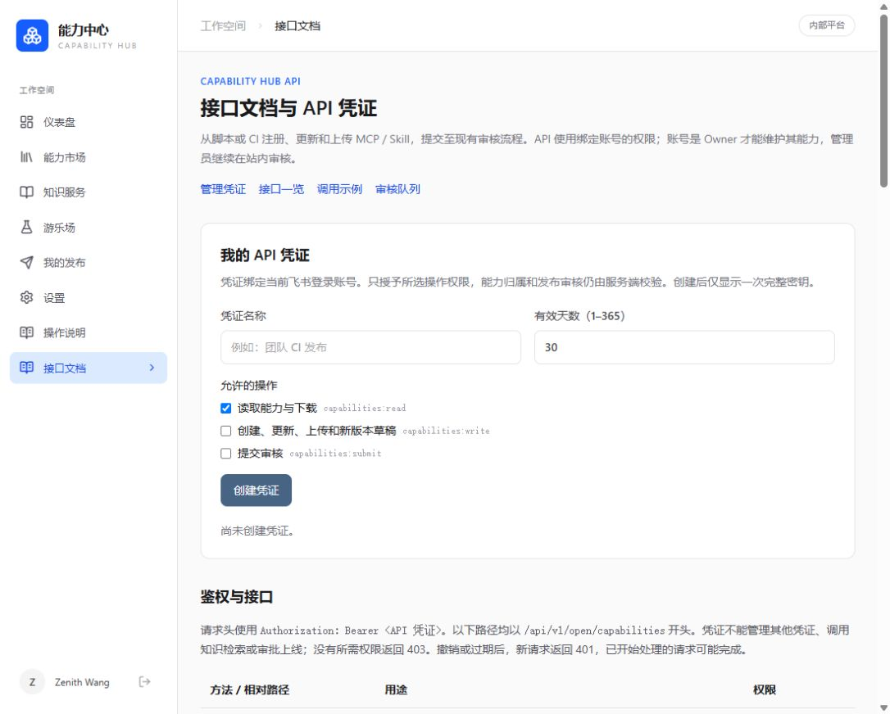

# 2026-10-27 飞书目录与发布 API 上线

2026-10-27 20:33（北京时间），经用户明确部署授权，并在用户确认飞书新增权限已发布后，将当前工作区版本部署到现有服务器 [hub.sn0w.icu](https://hub.sn0w.icu)。没有迁移服务器，没有 Git 提交或推送。

本文记录部署发生时的状态。随后用户授权将当前版本提交至 GitHub，合并批次内容与验证边界见[发布说明](../../releases/2026-10-27-directory-publishing-deployment.md)；原源码归档摘要和镜像记录保持不变。

## 本次包含

- 当前登录账号可见的飞书部门、人员选择；复用 OAuth 加密与刷新，按 ID 保存，真实部门归属独立校验。
- MCP / Skill 注册、更新、上传、新版本草稿及提交审核 API；账号绑定、scope、到期和撤销凭证，沿用原治理规则。
- 站内 [接口文档与凭证管理](https://hub.sn0w.icu/hub/api-docs)。已有模型适配、落地页、操作指南及登录跳转修复保留。

源码基于 `2690a0ff83cd48041f95fa28cbca1555ea4e8374` 加当前未提交/未跟踪文件，按 319 个源码文件的 SHA-256 清单打包并在服务器复核。首次发布为 `20261027-directory-api`；真实账号发现根节点可见性差异后，前后端更新为 `20261027-directory-api-root`。镜像 ID、两次源码包摘要及数据核对结果见 [release.json](release.json)。当前源码目录 `/opt/capability-hub/releases/20261027-directory-api-root`，`current` 已指向该目录。

## 备份、迁移和验证

1. 保留原业务配置，特别是 OAuth 加密密钥、飞书应用/回调、模型设置和 Docker 内网连接。前后端生产镜像构建成功。
2. 首先备份业务库并恢复到独立库 `capability_hub_directory_check_20261027`，用新镜像 `/app/migrate` 验证 17 → 19 → 17 → 19；既有八张表的条数和整行聚合校验值保持一致。旧后端镜像的迁移入口也能接受 schema 19，为镜像回退提供证据。
3. 切换时短暂停止后端，完成最终 custom-format PostgreSQL dump 和 MinIO 数据文件归档，验证归档目录与 SHA-256；随后执行新增迁移 18、19。再次核对既有八张表一致，embedding 保持 `vector(1024)`。没有回退或重建业务数据。
4. 最终备份在服务器 `/opt/capability-hub/backups/20261027-directory-api-final/`；数据库和对象备份已下载至忽略目录 `.cache/directory-api-deploy-20261027/final-backup/`，两份文件的 SHA-256 均与服务器一致。目录权限 700、配置 600，密钥未放入此验证记录。
5. 新前后端已启动，后端健康；HTTPS 首页、登录、指南、健康接口返回 200，未登录的认证、市场、知识库、目录、凭证和发布 API 返回 401。OAuth 发起包含全部六项 scope，未记录 state 或 Cookie，见 [health.json](health.json)。代理和 PostgreSQL/MinIO 等基础服务未重建。
6. 用户原登录会话跨更新保留；浏览器确认新“接口文档”导航、文档示例和本人凭证列表正常。飞书授权页实际列出新增三项权限，用户本人完成确认后正常返回工作台，令牌 scope 已包含所需权限。
7. 实际企业策略禁止查询组织根节点 `0`（飞书错误 `40004`），但允许查询本人部门和人员。补丁提供经当前用户令牌逐个核验的本人部门入口，并明确提示范围；不使用应用身份、不扩大可见范围、不从浏览结果更新归属。补丁相关 Go 测试/vet、选择器四项测试、类型检查和生产镜像构建通过，无新增数据库迁移。线上浏览器实际加载 1 个可见部门入口和 9 名直属人员，未出现目录错误；没有将企业人员名单或 ID 写入此记录。
8. 本轮隔离恢复库和临时验证配置已删除，备份、旧镜像和发布产物保留。

MCP / Skill 完整写入、审核及凭证创建/过期/撤销链路的验证使用[隔离数据库](../2026-10-27-directory-api/README.md)。本次线上检查没有创建测试能力或生产 API 密钥；线上 API 写入不计为已验收。

## 回退

上版后端 `capability-hub-backend:20261027-auth-redirect`、前端 `capability-hub-frontend:20261027-guide` 和原 `deploy.env` 均已保留。若需回退，恢复最终备份中的 `deploy.env`，使用当前 Compose 文件仅重建 backend/frontend，再核验健康和页面；不运行数据库 down/reset，不删除 HTTPS 数据卷。schema 18/19 为增量兼容变更，旧后端迁移入口已在隔离 schema 19 上验证。

仅回退根节点补丁可使用 `shared/deploy.env.before-directory-root` 和 `20261027-directory-api` 镜像；该版本在受限组织根节点下会再次显示权限提示。回退镜像后同时将 `current` 指向对应保留的 release 目录，避免源码指针与运行版本不一致。

