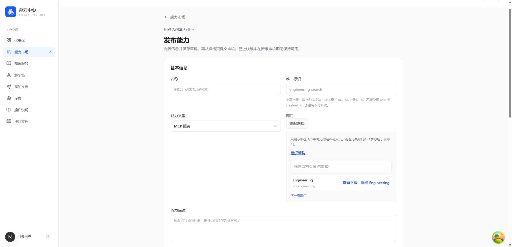
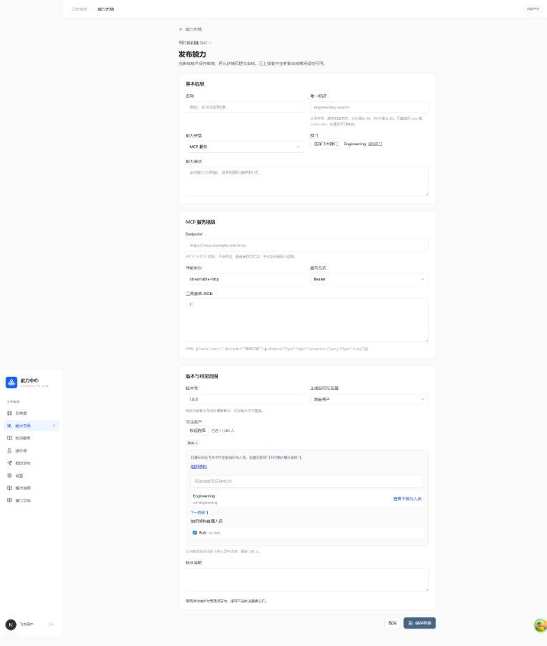

# 飞书目录与发布 API 验证记录

日期：2026-10-27。工作区分支 `main`，没有提交、推送或部署。原有部署、模型适配、落地页、指南和登录修复改动保留。

后续：同日用户另行授权后，已完成[服务器发布](../2026-10-27-directory-api-release/README.md)。以下“未部署”描述保留为实现阶段的验证边界。

## 实现与验收范围

- [设计](../../superpowers/specs/2026-10-27-directory-and-publishing-api.md)：用户身份目录、真实归属独立缓存、飞书 ID 关联；账号绑定且可限定 scope、过期和撤销的发布凭证。
- [飞书配置与重新授权](../../feishu-directory-setup.md)。本轮没有操作飞书后台，真实企业账号验收仍待管理员开通并发布新增权限、用户重新授权。
- [发布 API 文档](../../publishing-api.md)，站内 `/hub/api-docs` 提供凭证管理和 MCP / Skill 调用示例。

## 执行环境

使用已有 WSL Ubuntu-22.04、Go 1.27.0、sqlc 1.30.0、Node 24.19.0、pnpm 9.12.0；没有安装或升级项目依赖，没有混用 Windows / Linux 的 node_modules。

使用现有 Docker Desktop，临时容器 `capability-hub-directory-api-test`，镜像 `pgvector/pgvector:pg17`，只绑定 `127.0.0.1:15433`。测试 URL 显式指向该容器；新增目录集成测试拒绝非 localhost 主机，并创建带 UUID 的独立数据库。未对生产或开发业务库执行迁移。临时数据库、容器和浏览器验收服务已清理。

## 已通过

1. `sqlc generate`；生成代码与查询、迁移一并保留。
2. `go test ./...`、`go build -o /tmp/capability-hub-directory-server ./cmd/server`、`go vet ./...`。全量测试时显式提供隔离 `DIRECTORY_TEST_DATABASE_URL` 和 `REGISTRY_TEST_DATABASE_URL`，包含目录发布和现有 Registry / Governance PostgreSQL 测试。
3. `TestDirectoryPublishingIntegration`：迁移 17 → 19 → 17 → 19，原字符串部门数据保留；真实 OAuth 加密存储和刷新服务配合模拟飞书上游；目录分页、选择 ID 校验、可见范围与归属分离；过期归属不能授权；账号、scope、Owner/Admin、Cookie/Bearer、CSRF 边界；MCP 注册/更新/冲突/新草稿/提交/审核；Skill multipart/路径拒绝/下载隔离；凭证只存摘要、列表不泄露秘密、过期/撤销与审计关联。
4. 单独提供 `KNOWLEDGE_TEST_DATABASE_URL` 与 `KNOWLEDGE_TEST_DISPOSABLE=1` 运行 `TestKnowledgeCloudIntegration`：K1 隔离迁移、历史私有数据、应用 scope/grant、删除和撤销并发边界通过。该测试现优先使用显式测试 URL，不读取业务 `.env` 作为本次数据库配置。
5. 前端既有 23 文件 / 103 项测试通过；新增目录选择器、凭证组件的 2 文件 / 5 项测试通过；`pnpm typecheck`、`pnpm build` 通过，构建包含 `/hub/api-docs`。
6. Chrome 连接本地隔离站点（前端 13000、测试后端 18089）：接口文档和导航显示、凭证创建及撤销、部门 ID 选择、指定用户勾选和计数通过。截图仅为模拟账号与组织，无真实企业通讯录。
7. 最终补充空列表 `items:null` 规范化回归，`go test ./internal/infra/feishu ./internal/directory ./internal/publishing` 通过；`git diff --check` 通过。

## 边界

这些结果证明本地实现和隔离集成，不代表真实飞书账号、真实对象存储、生产环境或发布验收完成。后台权限、真实账号可见范围和实际部门归属须按飞书配置文档核验。新关联使用部门 ID；旧名称记录不自动猜测或批量迁移。迁移回滚只在一次性库测试，不能用于生产清理。

