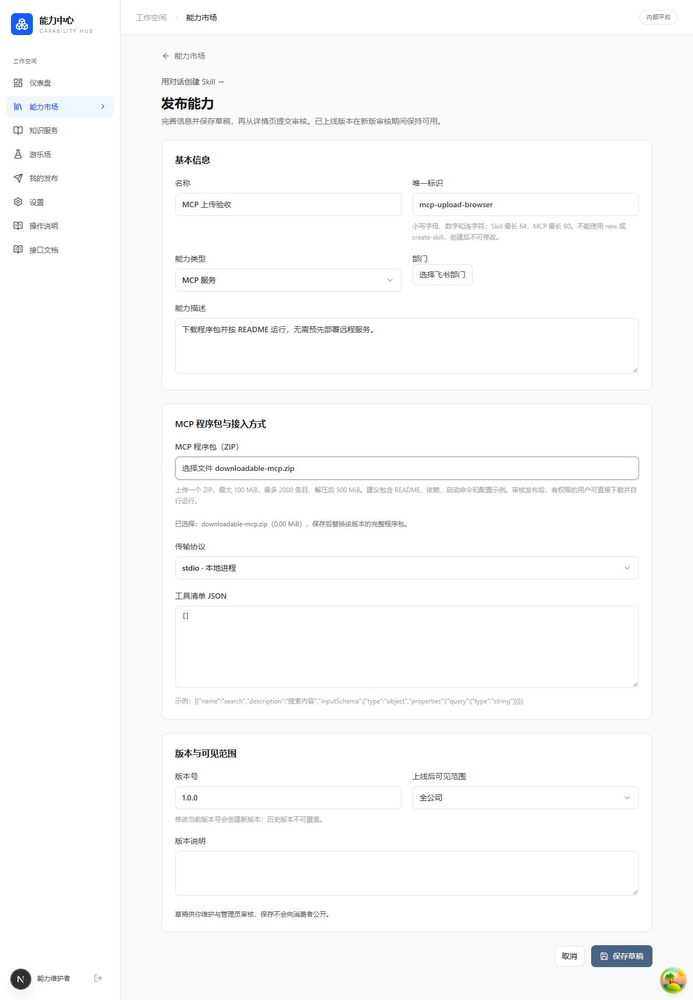
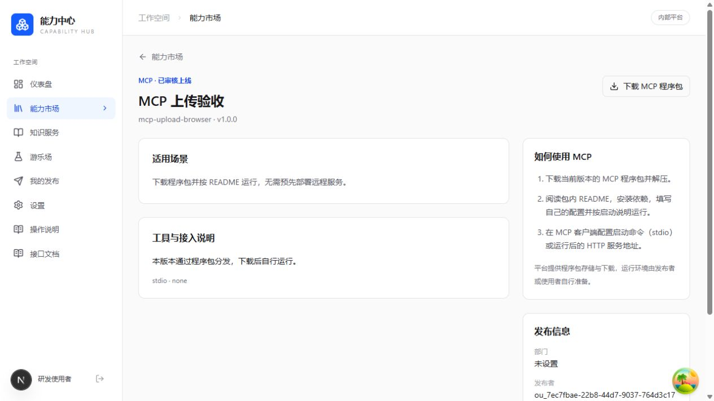

# MCP 程序包分发验证 · 2026-11-05

本地实现及验收完成；验收时尚未提交、推送或部署。用户随后授权提交并推送，交付范围和公司接力步骤见[本批交付说明](../../releases/2026-11-05-reviewers-mcp-packages.md)。公司部署仍待完成。设计：[MCP 程序包分发](../../superpowers/specs/2026-11-05-mcp-package-distribution.md)。

## 行为

- 发布者在注册/编辑中上传单个 ZIP（100 MiB），支持无 Endpoint 的 stdio/HTTP 程序包，也兼容旧远程 Endpoint，远程 MCP 可附包。
- 管理页、审核页和市场页按可见版本提供「下载 MCP 程序包」。下载原始 ZIP 附件，不要求手动操作 MinIO 或粘贴对象地址。
- 同一未发布版本可保留/替换包；新版本重新上传，旧上线包保持可用直到新版审核通过。版本与权限边界沿用现有治理。
- API 同样支持 multipart 上传和受 read scope 保护的下载；Skill 原有上传/预览/ZIP 行为保持。

## 自动验证

环境：现有 WSL Ubuntu-22.04、Go 1.27.0、sqlc 1.30.0、Node 24.19.0 / pnpm 9.12.0、Docker Desktop；依赖与锁文件未升级。测试仅使用临时 PostgreSQL 容器 `caphub-mcp-test-20261105` 的 UUID 数据库、虚构账号和内存对象存储，不连接业务库或公司 bucket。

- `sqlc generate`：完成；本次仅增加约束迁移，生成的类型/查询无新增差异（保留前一审核员任务生成变更）。
- `go test ./...`：通过；显式配置临时 `REGISTRY_TEST_DATABASE_URL` 与 `DIRECTORY_TEST_DATABASE_URL`，注册/治理/审核员/发布 API 隔离集成实际执行。其他依赖外部模型或服务的测试按原有环境门槛跳过，不计作真实服务验收。
- `go build -o /tmp/caphub-mcp-server-check ./cmd/server`：通过。
- 前端 `pnpm test`：26 文件、123 测试通过；`pnpm typecheck` 与 `pnpm build` 通过（21 静态页面）。
- ZIP 校验：原样保留、Windows/Unix 路径、重名/父子文件冲突、符号链接/特殊文件、加密、压缩方法、条目数/压缩和解压体积、CRC 损坏及取消。
- 上传失败不建版本；事务冲突仅清理确认未引用对象，未知提交结果不误删。
- HTTP 实际上传 11 MiB ZIP，超过原 Skill 10 MiB 限制；下载字节、附件响应和 no-store 验证通过。
- 草稿/待审/上线/下线下载，Owner/Admin/审核员/消费者及发布凭证隔离，CSRF，元数据保留包、替换、旧 revision 冲突、新版不可隐式继承、上线后不可覆盖、可见范围收紧验证通过。
- 迁移 0021 up/down/up 保留旧版本；存在程序包后 down 明确拒绝，迁移版本和原包保留。没有为回退删除或改写业务记录。

## 浏览器验收

在本地 fixture API `127.0.0.1:18089` 和前端 `localhost:13000` 使用虚构账号：

1. 使用者在市场详情点击下载，实际得到 ZIP。
2. 发布者在注册表单通过文件选择器选择该 ZIP，保持默认 stdio 且不填写 Endpoint，保存为 `mcp-upload-browser` 草稿。
3. 提交审核；独立审核员查看并通过上线。
4. 普通使用者在新市场详情点击「下载 MCP 程序包」，实际获得 ZIP。
5. 浏览器上传来源和最终下载文件 SHA-256 一致：`0fa0f0f8a17be227a8a5bb5ec518afd40ea62bf16b75317b2a5af6592841984c`。

浏览器 fixture 测试正常结束，通过（313.929s）；临时服务、数据库、容器和下载样本在验收后清理，页面截图保留。

## 发布边界

尚未部署到公司站点，未变更真实账号权限。现有 MinIO 适配器复用，本轮没有对公司 MinIO 做真实读写验收。平台仅存储、分发，不执行 MCP 或验证包内程序能在任意客户端运行；用户需按 README 准备环境。当前上传有界内存缓冲，沿用 API 请求超时，不包含断点续传或分片上传。

部署需应用迁移 0021；存有新 MCP 包/stdio 版本后不能直接回滚到不支持它们的旧 schema，迁移会主动阻止有损回退。
